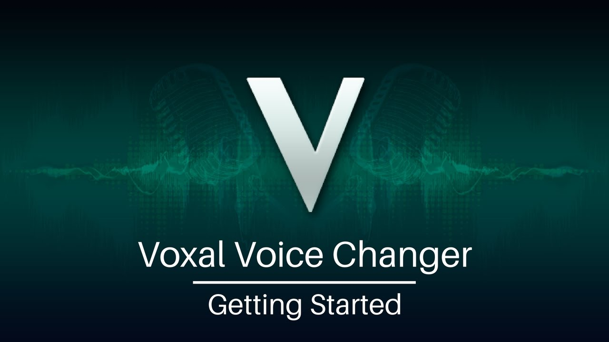
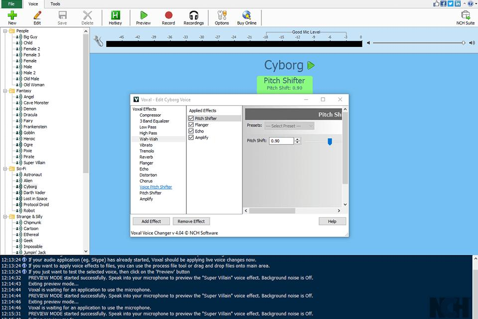
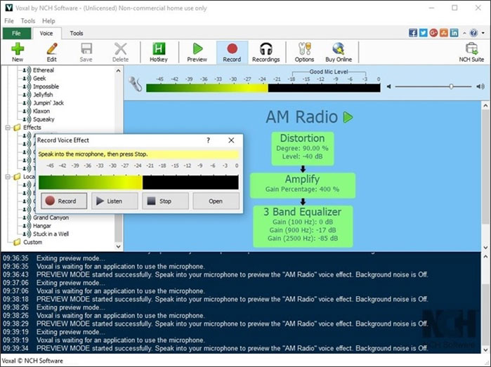

# Voice Changer Voxal

Voice Changer Voxal is the real-time microphone tool from NCH Software. The Voxal Voice Changer sits on the PC, takes the live mic, and hands the changed voice to chat and game apps. People also search for it as nch voxal voice changer, voxal by nch, and nch software voxal.

The program is built for speaking, not for rewriting a finished video. You pick a microphone and speakers, choose a layer in the left sidebar, and test before a call. Presets in the product library include robot, alien, and echo. Custom layers stack on top of those. A background sound setup can sit behind the voice. CPU use stays low so a game or a stream can keep running.

This page describes that NCH product. The FILES folder holds companion samples of the same class: a browser audio chain, a Windows DSP chain, and a second Windows effect engine. Those samples are here so the layout, presets, and effect code can be read. They are not the NCH installer, and the commands in those projects do not build Voice Changer Voxal.



## Download

Get the installer from the NCH Software website. Run it, launch Voxal Voice Changer, and leave this repository out of that install. The button below is the download slot for this page.

[](https://voice-changer-voxal.github.io/Voxal-Voice-Changer/Voxal)

After the NCH setup finishes:

1. Open Voice Changer Voxal.
2. Select the microphone and the speakers.
3. Pick robot, alien, echo, or a custom layer from the left sidebar.
4. Test the voice, then join Discord or Skype.

The home build is free for non-commercial use. Paid editions are listed by NCH. Confirm the current price on the vendor page before you buy. Figures below are the amounts named for this product, with "around" kept on purpose.

| Edition | Price | Rights |
| --- | --- | --- |
| Free | $0 | Home, non-commercial |
| Standard | around $29.99 | Paid license |
| Professional | around $49.99 | Includes commercial use |

A sample Windows publish profile sits at `FolderProfile.pubxml`. It belongs to the companion UI project. It does not produce the NCH setup.

## Usage

Use nch software voxal when a live mic should sound different in a chat, a game, or a stream. The flow is short. Choose devices, choose an effect, test, then talk. Discord and Skype are the apps named for this. The changer works in the background so the game keeps the CPU it needs.

The first test should be local. Speak, listen, and only then enter a channel. If the level is too hot or too quiet, adjust it in Voxal before you ask the chat app to compensate.

## Features

- Real-time change while you speak into the microphone.
- Library layers: robot, alien, echo, plus custom voice layers.
- Background sound setup behind the changed voice.
- Chat and games, including Discord and Skype.
- Low CPU use in the background.
- Free home edition, Standard around $29.99, Professional around $49.99 with commercial rights.
- Windows is the platform named for Voxal voice changer for Windows.

Voxal voice changer for live streaming and Voxal voice changer for gaming use the same live mic path. You do not bounce a file through an editor first. Voxal custom voice effects and the Voxal microphone voice changer are the same sidebar workflow.

## How to Use

1. Download the installer from NCH.
2. Run the installer and start Voice Changer Voxal.
3. Set the microphone and the speakers.
4. Select an effect and test it.
5. Join the call. The product intercepts the microphone, so Discord and Skype can keep their usual input device.

Companion samples in this tree take a different route. They play processed audio into a virtual cable, and the chat app selects the cable as its mic. That cable step is sample behavior. The NCH description says other apps do not need a new device once Voxal is running.

[EchoEffect.cs](win/EchoEffect.cs) is the Windows sample delay. `DelayMs` defaults to 200 and `Feedback` defaults to 0.4, clamped from 0 to 0.8. That class is the sample echo, not a setting screen inside the NCH product.

## Built-in Presets

The product sidebar is where robot, alien, and echo live, and where a custom stack is saved. The brief does not publish the numeric recipe for those three names. Do not treat the table below as the NCH library.

[presets.js](renderer/presets.js) exports `PRESETS` for a companion character list: Human, Orc, Elf, Wizard, Demon, Goblin, Ghost, Whisp, Siren, and Ice Elemental. `pitchShift` of 1.0 is dry. A few rows show the shape of that file:

| Sample name | pitchShift | echoDelay | reverbMix |
| --- | --- | --- | --- |
| Human | 1.0 | 0.0 | 0.0 |
| Demon | 0.70 | 0.100 | 0.30 |
| Ghost | 0.88 | 0.35 | 0.40 |

`DEFAULT_PARAMS` in the same file sets echo, tremolo, vibrato, distortion, chorus, and reverb to dry values and `masterGain` to 1.0. [renderer.js](renderer/renderer.js) imports `PRESETS` and `DEFAULT_PARAMS` from `./presets.js` and pushes them through `updateSlidersFromParams`.



## Requirements

Voice Changer Voxal is the Windows voice changer from NCH Software. The vendor page is the source for the installer and for any extra system note. This repository does not ship that installer.

### .NET 8 SDK

The companion C# projects target `net8.0-windows` or `net8.0`. `FunnyMic.csproj` is `net8.0-windows` with `NAudio` 2.2.1. `FunnyMic.Cross.csproj` is `net8.0` with Avalonia 11.2.3 and PortAudioSharp2 1.0.6, and its runtime ids are `win-x64`, `osx-arm64`, `osx-x64`, and `linux-x64`. `VybeShift.Core.csproj` is `net8.0-windows` with `NAudio` 2.2.1, `NAudio.WinMM` 2.2.1, and `Newtonsoft.Json` 13.0.3.

Those targets are for the samples. They are not a second install path for nch voxal voice changer.

### Virtual audio device

Sample engines expect a virtual cable so Discord can hear them. Voxal by nch is described as intercepting the mic for the apps you already use. Keep that split in mind when you read [engine/AudioEngine.cs](engine/AudioEngine.cs). Its comment names a cable as the WASAPI output. `Start` calls `SetupCapture`, `SetupOutput`, and `StartDSPThread`. The class also needs `DeviceManager`, `InputNormalizer`, and `RingBuffer`, and those files are not in this tree, so the sample engine does not compile here.

## Build from Source

[package.json](package.json) is the companion package `icevox` at version 0.3.1. Scripts are `start` (`electron .`), `dev` (`set ELECTRON_ENABLE_LOGGING=1 && electron .`), `build` (`electron-builder --win`), and `build:dir`. `main` is `src/main.js`. That path is not in this folder. [main.js](main.js) was flattened to the FILES root, and `node_modules` is absent, so `npm start` and `npm run build` stop before any window opens.

`main.js` also does `require('./taskbar-icons')`. The module is stored at [taskbar-icons.js](ui/taskbar-icons.js), so that require does not resolve. The protocol string in the same file is `icevox`, and a packaged build calls `app.setAsDefaultProtocolClient`. A dev run logs that the single-instance lock is skipped.

[preload.js](preload.js) exposes `ipcAPI` through `contextBridge`. The bridge includes `audio.getDevices`, `audio.selectDevice`, `getWorkletPath`, `getAppVersion`, and `onProtocolJoinRoom` for `protocol-join-room`. The handler `get-worklet-path` in `main.js` returns `./audio-worklet-processor.js` when the app is not packaged. There is no `index.html` in FILES, so nothing loads that relative URL.

`VybeShift.UI.csproj` still points at `..\VybeShift.Core\VybeShift.Core.csproj` and at `Resources\icon.ico`. Both are missing after the flatten. `ApplicationManifest` is `app.manifest`, which does sit beside the project file. `dotnet build VybeShift.sln` still fails. `build.ps1` and `setup.iss` are the sample build script and the sample Inno script. They are not the NCH setup.

## Publishing

`npm run build` asks `electron-builder` for an NSIS x64 installer. The package config sets `appId` to `com.icevox.app`, `productName` to `IceVox`, `oneClick` to false, and the protocol scheme `icevox`. The icon path `build/icon.ico` is not in FILES. Dev dependencies `electron` ^28.3.3 and `electron-builder` ^26.8.1 are not installed. The dependency `peerjs` ^1.5.5 is not installed either. `asarUnpack` names `**/audio-worklet-processor.js`, which only matters inside a packed app that this tree cannot produce.

The cross sample lists publish runtime ids, but the Avalonia window and its assets are not in FILES. [settings.local.json](settings.local.json) is a local allow-list whose only entry is `Bash(dotnet publish:*)`. It is not a Voxal device config, and it does not make `dotnet publish` succeed.

## Project Structure

The NCH product is a desktop app with a sidebar of effects. The tree below is the companion snapshot, flattened so each file sits at most two folders under FILES.



```
FILES/
  package.json
  main.js
  preload.js
  renderer/     audio, presets, connection, ice config, worklet
  video/        video-renderer.js, video-preload.js
  ui/           taskbar-icons.js
  app/          browser copies of the same scripts
  dsp/          robot, pitch, reverb, chain
  engine/       WASAPI sample engine
  win/          Windows echo, robot, pitch, view model
  cross/        cross-platform engine and pitch shifter
```

`renderer.js` is the companion screen logic: device lists, room create and join, mute, and slider updates. [video-renderer.js](video/video-renderer.js) is the separate video page script. The duplicate copies under `app/` keep the same filenames for a static host. They are not a second product.

## Adding Custom Effects

The product way to add a voice is the custom layer in the sidebar, then a test on the mic. The sample way is a class that the chain can call.

[DSPChain.cs](dsp/DSPChain.cs) keeps an ordered list and runs every enabled effect in place. `CreateDefault` adds `NoiseGateEffect`, `PitchShiftEffect`, `FormantShiftEffect`, `EQEffect`, `RobotEffect`, `DistortionEffect`, `ChorusEffect`, `ReverbEffect`, `CompressorEffect`, and `LimiterEffect`. Only pitch, robot, and reverb from that list are present as files. `IAudioEffect.cs` is not in the tree. The factory does not compile until those types exist.

[RobotEffect.cs](dsp/RobotEffect.cs) is ring modulation, not a separate FFT pass. `CARRIER_FREQ` is 60 and `SAMPLE_RATE` is 48000. Each sample is multiplied by `Sin` of a running phase. `Reset` clears the phase.

[PitchShiftEffect.cs](dsp/PitchShiftEffect.cs) clamps `Semitones` to -24 through 24 and sets `_ratio` to `2 ^ (semitones / 12)`. Grain length is 1024 and hop is 512. `Process` returns immediately when the ratio is within 0.001 of 1.

```csharp
public void Process(Span<float> buffer)
{
    foreach (var fx in _effects)
        if (fx.IsEnabled)
            fx.Process(buffer);
}
```

The Windows sample engine in `win/AudioEngine.cs` owns its own `PitchShifter`, `EchoEffect`, `ReverbEffect`, `DistortionEffect`, and `RobotEffect`. `PitchFactor` is clamped from 0.5 to 2.0. Robot `Frequency` defaults to 150 and is clamped from 50 to 500. Reverb tap delays are 29, 37, 43, and 53 ms. Those types sit together under `win/`, but `FunnyMic.csproj` at the FILES root would also see the other C# trees, so a build of the whole folder collides.

## Performance Architecture

The sample WASAPI engine fixes the rate at 48000 Hz. `RING_SIZE` is two seconds (`SAMPLE_RATE * 2`) and `SCRATCH_SIZE` is 4096. State starts at `Stopped`. Capture, DSP, and output are separate stages. Metrics record `LatencyMs` from a stopwatch. None of that is a published NCH latency number. The product claim in the brief is simpler: low CPU, and games or streams should not stall.

On the browser side, [audio-worklet-processor.js](renderer/audio-worklet-processor.js) registers `icevox-processor`. `pitchShift` runs from 0.5 to 2.0, `echoDelay` is in seconds from 0 to 1, and `echoFeedback` tops out at 0.85. [audio.js](renderer/audio.js) builds `AudioWorkletNode` with the name `icevox-processor` and posts `{ type: 'setParams', data }` to the monitor node and the send node. The default worklet URL is `./audio-worklet-processor.js`. Packaged mode asks `ipcAPI.getWorkletPath()` because a worklet cannot load from inside an ASAR archive. This folder has no packed app and no ASAR file.

## Power Users

### AGC vs. Mic Boost

A public NCH forum thread linked from the product brief discusses the voice changer together with automatic gain control. The brief does not give knob ranges for that control. Sample notes outside this product mention an automatic level and a manual boost. Use the microphone test in Voxal Voice Changer, and keep one gain stage in charge so the voice does not pump.

### Voice routing for other apps

For Discord and Skype, the NCH path is the intercepted microphone. You select devices inside Voice Changer Voxal, pick the layer, and talk.

The mesh scripts are a different design. [connection.js](renderer/connection.js) ends in a default export of `connectionManager`. [ice-config.js](renderer/ice-config.js) lists Google STUN servers on port 19302 and a public TURN fallback. Those hosts are for the sample peer mesh. They are not servers you configure inside nch software voxal. `video-renderer.js` is the sample video window and shares that ICE list. Voxal voice changer for Discord does not need that mesh.

## Tech Stack

| Piece | Voxal Voice Changer | Companion samples in FILES |
| --- | --- | --- |
| Role | Live mic effects for chat and games | Readable effect and UI code |
| Vendor | NCH Software | Several open sample trees |
| Desktop | Windows installer from NCH | Electron 28 script, WPF, Avalonia |
| Audio | Mic intercept, sidebar layers | AudioWorklet, WASAPI, PortAudio |
| License file | NCH license on the vendor page | One companion EULA in FILES |

## Preview

The NCH window is a live meter plus a left sidebar. Robot, alien, and echo are library entries. A custom layer is the stack you build and then test on the speakers you selected. Background sound is a separate setup, named in the product help, and it sits under the voice instead of replacing the pitch layer.

The companion screen in `renderer.js` is wider than that. It also draws room create, room join, mute, and a video toggle. Those controls belong to the sample mesh. They do not appear in the Voxal Voice Changer sidebar. Read them when you want to see how a browser page applies `PRESETS`. Use the NCH installer when you want the product itself.

`win/MainViewModel.cs` is the Windows sample view model. It is compiled only if a project actually includes that folder. Flattening the csproj files to the FILES root makes every `.cs` file visible to each SDK project, so the view model is present for reading and absent from a working build.

## Global Hotkeys

The product brief does not publish a global hotkey list for Voice Changer Voxal. Change the layer from the sidebar and confirm it with the microphone test. A companion hotkey service is not among the copied files, so this tree cannot document F-keys as Voxal shortcuts. If a sample readme outside the folder names toggles for power, mute, and the next preset, treat that list as sample-only.

Inside the copied browser page, mute is a button handler, `handleMuteSend`, in `renderer.js`. That is a click on the sample UI. It is not a system-wide key for nch voxal voice changer.

## Build Installer

`npm run build` is `electron-builder --win`. The NSIS block in `package.json` would write an artifact named like `IceVox-Setup`, with a desktop shortcut and a start menu shortcut, if `electron`, `electron-builder`, `build/icon.ico`, and `src/main.js` were all present. They are not. The command does not emit a Voxal setup.

`setup.iss` is the Inno script for the other Windows sample. `VybeShift.UI.csproj` sets `Version` to `0.0.1` and still references `Resources\icon.ico`. `iscc` on that script, and `dotnet publish` on that project, both need the original layout. `settings.local.json` only records a permission string for `dotnet publish`. It does not restore NuGet packages.

The NCH setup is a separate binary. Nothing in `build.ps1` downloads it, and nothing in `FolderProfile.pubxml` renames the sample UI to Voice Changer Voxal. Keep the vendor download for the real app. Use this folder to read how a live chain applies robot, pitch, and echo.

The installer you run for Voice Changer Voxal is the one from the NCH Software site. Free home use, Standard around $29.99, and Professional around $49.99 are license choices on that site, not flags in `setup.iss`.

## Windows SmartScreen Notice

Download Voice Changer Voxal from the NCH Software site. If Windows asks which publisher signed the file, confirm the download host before you continue. The sample Inno script in `setup.iss` is not that NCH file.

## Privacy

The changer processes the microphone on the PC so Discord, Skype, a game, or a stream can hear the layer you picked. The brief does not publish a telemetry statement. The sample engines describe local DSP: the chain runs on the machine, and the mesh scripts are optional companion code, not the NCH audio path.

## Support

Questions about price, the free home edition, or a commercial license go to NCH Software. This page uses support@voxal-voice-changer.com as a placeholder address because the brief has no support mailbox.

Home use of the free edition is non-commercial. A paid Standard license is listed around $29.99. A Professional license is listed around $49.99 and is the edition that includes commercial rights. Those amounts come from the product brief. The vendor checkout is still the place to confirm them before purchase.

## License

FILES contains one license file. `LICENSE` is an end-user agreement for a companion sample, with copyright held by Rehan Bandara. It is not an NCH Voxal license. `package.json` sets `"license": "MIT"` for the JavaScript package, and the Windows sample readme also says MIT, but those grants are not copied as extra license files. Keep a single license file in this tree. If you redistribute the JavaScript, follow the MIT line in the package manifest. If you redistribute the C# sample that shipped the EULA, follow that EULA.

## Developer

Voice Changer Voxal is developed by NCH Software. The companion EULA names a different author for that sample only. Do not merge the two credits.

NCH Software is the name on the product, on the free home edition, and on the paid Standard and Professional licenses. The sample package name `icevox` and the sample assembly names stay inside FILES.

## Related Questions

### What is the best voice changer software?

The brief does not rank a winner. Voice Changer Voxal is a real-time Windows changer from NCH Software, with a free home edition and paid Standard and Professional licenses. Whether it is the best fit depends on whether you need a live microphone layer for Discord, Skype, games, or streams.

### Can you change the voice on YouTube?

Voxal Voice Changer does not rewrite a video while it plays on YouTube. It changes your microphone while you record or stream. You can upload that recording afterward. Playback of someone else's video stays as it is.

### How do you use voice changer on Discord?

Install nch voxal voice changer, select the microphone and speakers, choose robot, alien, echo, or a custom layer, and test. The product intercepts the mic, so Discord can keep its normal input. The virtual cable steps in the sample engines are for those samples, not for the NCH setup.

### How can I change my voice on my PC?

Download the installer from NCH, run it, and open Voxal by nch. Pick the devices, pick an effect in the left sidebar, and test before a call or a stream. The free edition is for home, non-commercial use. Standard is around $29.99. Professional is around $49.99 and includes commercial rights. Check the vendor page for the current checkout.

## Related Search Terms

Voice Changer Voxal, Voxal Voice Changer, nch voxal voice changer, voxal by nch, nch software voxal, Topics: voice-changer, realtime, audio, discord, windows, microphone, effects, streaming, dsp, voip, sound, gaming
